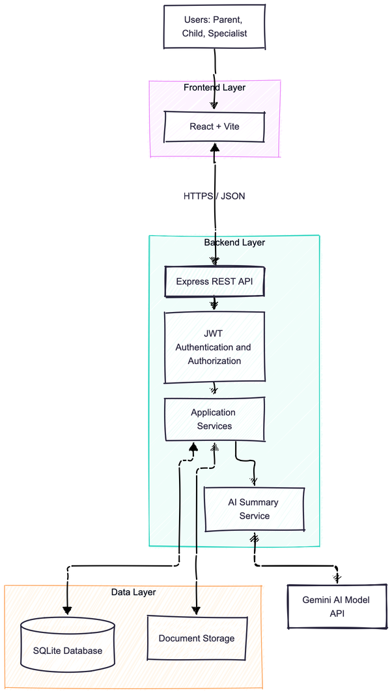

# Software Design Document (SDD)

**Team name:** Golden Trio  
**Version:** ☒ First version (Week 6) ☐ Final (Week 10)  
**Last updated:** 2026-10-31

---

## 1. Architecture Overview

Lumi uses a layered client–server architecture with a React frontend, an Express REST API and a SQLite database; the backend handles authentication, access control and application logic. Uploaded documents are stored in a local directory, while their metadata and sharing permissions are stored in SQLite. A dedicated backend AI service sends only authorized records to the selected AI provider and supports mock mode for testing.

### Technology Stack

| Layer | Technology |
|---|---|
| Frontend | React, Vite |
| Backend | Node.js, Express |
| Database | SQLite |
| Authentication | JWT, bcrypt password hashing |
| Document storage | Local filesystem; metadata and permissions in SQLite |
| AI integration | Gemini API or GitHub Models, accessed through a backend service with mock mode |
| Testing | Vitest, Jest, Supertest, Playwright |
| CI | GitHub Actions |

---

## 2. Module Design

| Module | Main components | Implements requirements |
|---|---|---|
| M1 – Registration, Login and Roles | RegisterPage, LoginPage, AuthService, UserRepository, JWT authentication middleware, role authorization middleware | FR-M1-01–06 |
| M2 – Access Permissions | LinkedSpecialistsPage, MyChildrenPage, LinkSpecialistForm, UnlinkConfirmation, SpecialistLinkService, child access middleware | FR-M2-01–FR-M2-05 |
| M3 – Weekly Schedule | ParentProgramPage, ChildSchedulePage, WeeklyCalendar, UpcomingActivities, EventValidator, ScheduleService, EventRepository | FR-M3-01–FR-M3-06 |
| M4 – Tasks | ParentTasksPage, ChildTasksPage, SpecialistAssignedTasksPage, TaskForm, TaskList, TaskSearch, TaskService, TaskRepository | FR-M4-01–FR-M4-07 |
| M5 – Specialist Entries | ExpertInputsPage, SpecialistEntryForm, ObservationCard, ObservationFilters, ObservationService, ObservationRepository | FR-M5-01–FR-M5-06 |
| M6 – Documents | DocumentsPage, DocumentUpload, DocumentList, DocumentSharingControls, DocumentService, DocumentRepository, document authorization middleware, local file storage | FR-M6-01–FR-M6-11 |
| M7 – Weekly Statistics | StatisticsPage, PeriodSelector, TaskStatusSummary, CategoryCompletionChart, DailyProgressChart, WeeklyTrendChart, StatisticsService | FR-M7-01–FR-M7-09 |
| M8 – Role-Based AI Summary | AISummaryPanel, SummaryFeedback, AISuggestionCard, AIService, parent and specialist prompt templates, AIProviderAdapter, MockAIProvider, AIRepository, M4 TaskForm integration | FR-M8-01–FR-M8-10 |

---

## 3. Data Model

---

## 4. API / Interfaces

| Method | Endpoint | Description | Module |
|---|---|---|---|
| POST | `/api/auth/register` | Register a new user | M1 |
| POST | `/api/auth/login` | Authenticate a user | M1 |
| POST | `/api/specialists/link` | Link a specialist to a child | M2 |
| GET | `/api/schedule` | Retrieve a child's weekly schedule | M3 |
| GET | `/api/tasks` | Retrieve assigned tasks | M4 |
| POST | `/api/tasks` | Assign a new task | M4 |
| PATCH | `/api/tasks/:id` | Update task completion status | M4 |
| GET | `/api/observations` | Retrieve specialist observations | M5 |
| POST | `/api/observations` | Create a specialist observation | M5 |
| POST | `/api/documents` | Upload a document | M6 |
| GET | `/api/documents` | Retrieve accessible documents | M6 |
| GET | `/api/statistics/weekly` | Retrieve weekly task statistics | M7 |
| POST | `/api/ai/summaries` | Generate an AI summary | M8 |

---

## 5. Critical Flows

Pending definition in SRS Section 4. The current SRS contains only Sections 1 and 2; the three critical flows and their sequence diagrams will be added after the corresponding SRS flows are defined.

### Flow 1: To be defined

### Flow 2: To be defined

### Flow 3: To be defined

---

## 6. User Interface

| Screen | Image | Module |
|---|---|---|
| Login Screen |  | M1 |
| Registration Page |  | M1 |
| Linked Specialists |  | M2 |
| Specialist’s My Children |  | M2 |
| Parent’s Weekly Schedule |  | M3 |
| Child’s Schedule |  | M3 |
| Parent’s Tasks |  | M4 |
| Child’s Tasks |  | M4 |
| Specialist’s Assigned Tasks |  | M4 |
| Specialist’s New Entry |  | M5–M6 |
| Parent’s Expert Inputs |  | M5–M8 |
| Documents |  | M6 |
| Statistics |  | M7 |
| Parent’s Dashboard |  | M8 |

---

## 7. Change Log

| Date | Change | By |
|---|---|---|
| 27.10.2026 | First version of the Software Design Document. | Golden Trio |
| 28.10.2026 | Created Data Model. | Golden Trio |
| 31.10.2026 | Reformatted to match the provided SDD template and linked UI screenshots from docs/img/. | Golden Trio |
