# Software Requirements Specification (SRS)

**Team name:** Golden Trio  
**System name:** Lumi — AI-Assisted Child Development Platform  
**Version:** ☒ First version (Week 6) ☐ Final (Week 10)  
**Last updated:** 2026-10-26

---

## 1. Introduction

**Purpose of the system:**

Lumi is a web-based decision support platform that brings parents and specialists together to follow a child's development through shared schedules, tasks, observations and documents. It provides weekly statistics and role-based AI summaries to support human decisions.

**Users of the system:**

| User type | Description |
|---|---|
| Parent | Owns the child's data, sees all of the child's records and manages specialist links. |
| Child | Sees only their own tasks and schedule and marks their tasks as completed. |
| Specialist | A teacher, psychologist who accesses records only for linked children. |

---

## 2. Functional Requirements

All requirements below are Must for v1.0. A linked specialist can access all records of a linked child; per-record sharing permissions are outside the required scope. Each task has one development area selected from the application's predefined area list, shared by task forms and statistics.

### M1 – Registration, Login and Roles

| ID | Requirement | Priority |
|---|---|---|
| FR-M1-01 | The system shall authenticate an existing parent or specialist account using its email address and password and issue a JWT after successful authentication. | Must |
| FR-M1-02 | The system shall reject invalid login credentials without issuing a JWT. | Must |
| FR-M1-03 | The system shall obtain the user's role from the stored account and display the screens permitted for that role without allowing role selection at login. | Must |
| FR-M1-04 | The system shall reject protected API requests with a missing, invalid or expired JWT using HTTP 401. | Must |
| FR-M1-05 | The system shall enforce role and child access permissions in the API: parents may access only their own children's data, specialists only linked children's data, and children only their own tasks and schedule; other authenticated requests shall receive HTTP 403. | Must |
| FR-M1-06 | The system shall allow a new user to register by entering their first name, last name, a unique email address, password and account role, and shall reject registration if the email address is already registered. | Must |
| FR-M1-07 | The system shall allow an authenticated parent to create a child profile by entering the child's first name, last name,age, date of birth and grade, and shall automatically link the profile to that parent. | Must |
| FR-M1-08 | The system shall allow a parent to list their linked child profiles and select a child to view that child's records and assign tasks. | Must |
| FR-M1-09 | The system shall reject child profile creation when any required field is missing or the date of birth is in the future. | Must |
| FR-M1-10 | The system shall allow an authenticated parent to generate a random, single-use login code for a child profile belonging to that parent and display the code only to the parent. | Must |
| FR-M1-11 | The system shall authenticate a child using a valid login code, mark the code as used and issue a JWT containing the Child role and the associated child profile ID. | Must |
| FR-M1-12 | The system shall expire each login code 10 minutes after generation and invalidate any previous unused code for the same child when a new code is generated. | Must |
| FR-M1-13 | The system shall reject incorrect, expired or previously used login codes without issuing a JWT and block further code-login attempts from the same client IP for 10 minutes after five consecutive failed attempts. | Must |

#### Figure 1 - Register Page

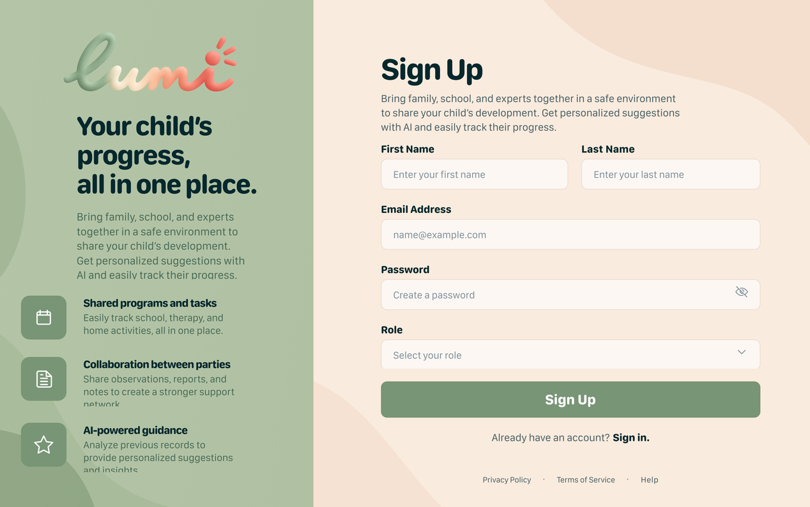

Registration screen: Name, email, password and confirm password fields, a “Register” button and a link to the login screen.

#### Figure 2 - Log In Page

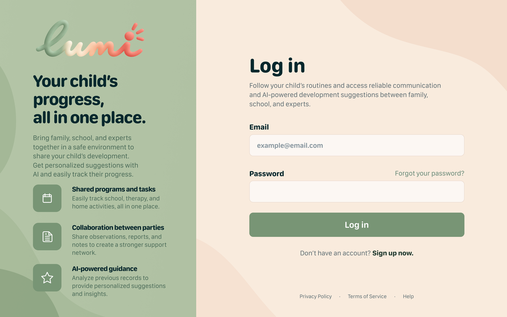

Login screen: Email and password fields, a “Login” button and a link to the registration screen.

### M2 – Specialist Linking and Access Control

| ID | Requirement | Priority |
|---|---|---|
| FR-M2-01 | The system shall allow a parent to link a registered specialist to their child using the specialist's email and specialist type. | Must |
| FR-M2-02 | The system shall reject a link request for an unregistered email or an account without the specialist role and display an error without creating a link. | Must |
| FR-M2-03 | The system shall list the specialists linked to a parent's child and list the linked children for each specialist. | Must |
| FR-M2-04 | The system shall request confirmation before unlinking a specialist and remove the link only after the parent confirms. | Must |
| FR-M2-05 | The system shall reject every subsequent API request by an unlinked specialist concerning that child with HTTP 403, including requests using previously obtained record IDs or download URLs. | Must |

#### Figure 3 - Access Permission Page

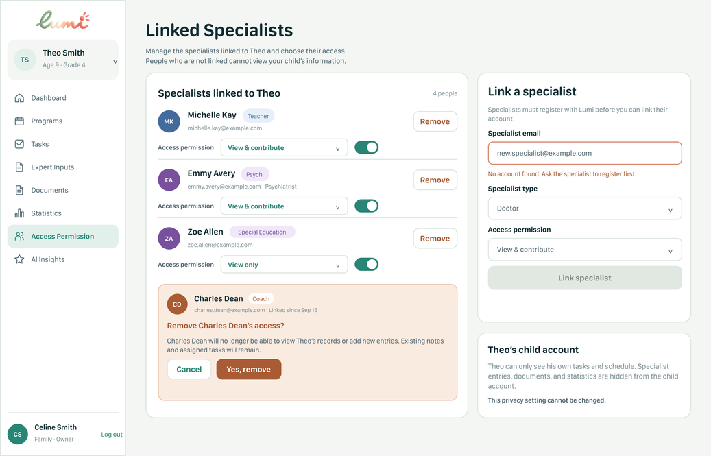

Parents can link registered specialists using their email and specialist type, view linked specialists, and remove their access after confirmation. Unlinked specialists cannot access the child’s records.

#### Figure 4 - Specialist’s My Children Page

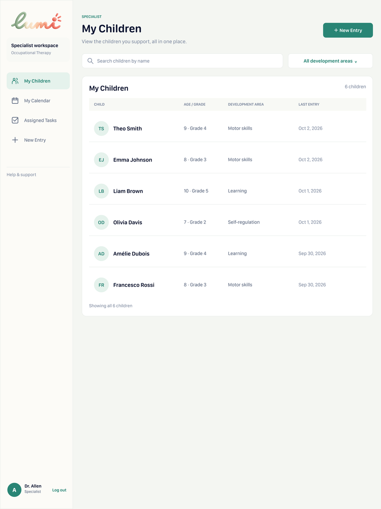

The My Children interface supports FR-M2-03 by displaying the children linked to the signed-in specialist in a list. Each row presents the child’s name, age, grade, development area, and latest entry date. Search and filtering controls help the specialist locate a child.

### M3 – Weekly Schedule

| ID | Requirement | Priority |
|---|---|---|
| FR-M3-01 | The system shall reject events with missing required fields. | Must |
| FR-M3-02 | The system shall display the child's events in a Monday-to-Sunday weekly calendar, showing each event's title and time under the corresponding day. | Must |
| FR-M3-03 | The system shall allow children to view their own schedule without adding or modifying events. | Must |
| FR-M3-04 | The system shall distinguish event categories using labels and colours for School, Extracurricular, Health and Other. | Should |
| FR-M3-05 | The system shall display upcoming events in chronological order, including each event's title, date and time. | Should |
| FR-M3-06 | The system shall display “No scheduled activities” for days without events. | Must |

#### Figure 5 - Parent’s Program Page

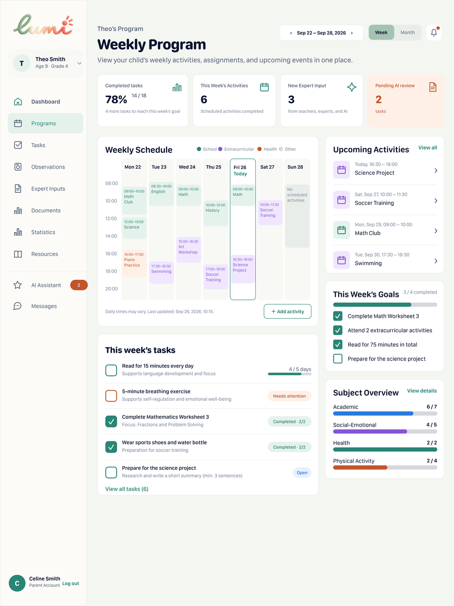

The Weekly Program interface displays the child’s events in a Monday-to-Sunday calendar, showing each activity’s title and time. Labels and colours distinguish event categories, while the Upcoming Activities panel lists events chronologically. Days without events display “No scheduled activities.” This interface supports FR-M3-03, FR-M3-05, FR-M3-06, and FR-M3-07.

#### Figure 6 - Child Schedule Page

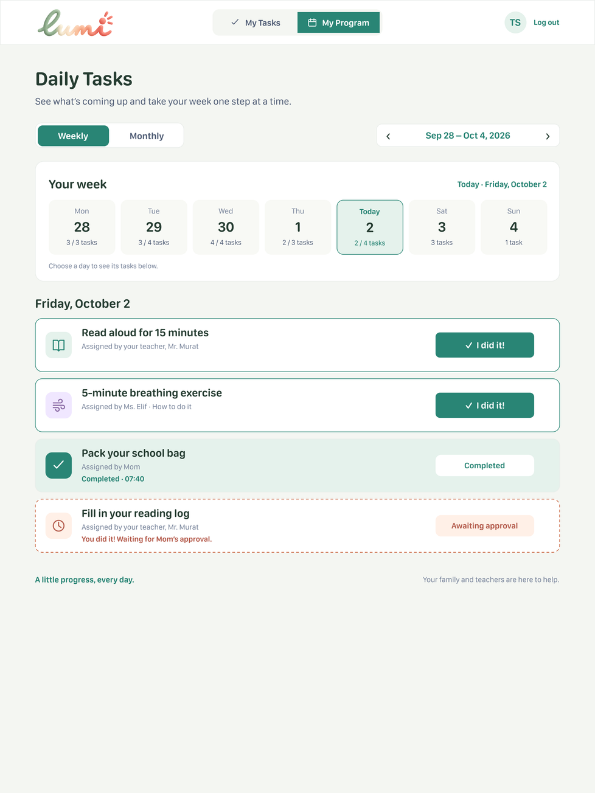

The My Program interface allows the child to view their own schedule using weekly and monthly views. The child can see the tasks for the selected day without controls for adding or modifying scheduled events. This interface supports FR-M3-04.

### M4 – Tasks

| ID | Requirement | Priority |
|---|---|---|
| FR-M4-01 | The system shall allow a parent or linked specialist to assign a task to a child by entering a title, description, category and due date, with an initial status of Not Started. | Must |
| FR-M4-02 | The system shall reject task creation if any required field is missing. | Must |
| FR-M4-03 | The system shall allow a child to view their own tasks and mark a task as Completed. | Must |
| FR-M4-04 | The system shall save each task's completion status and completion timestamp and display the updated status to the assigner. | Must |
| FR-M4-05 | The system shall allow a parent to view all tasks assigned to their child and a linked specialist to view the tasks they assigned to linked children. | Must |
| FR-M4-06 | The system shall allow a child to change a task's status from Not Started to In Progress before completing it. | Should |
| FR-M4-07 | The system shall allow specialists to search their assigned tasks by task title or child name. | Should |

#### Figure 7 - Parent’s Task Page

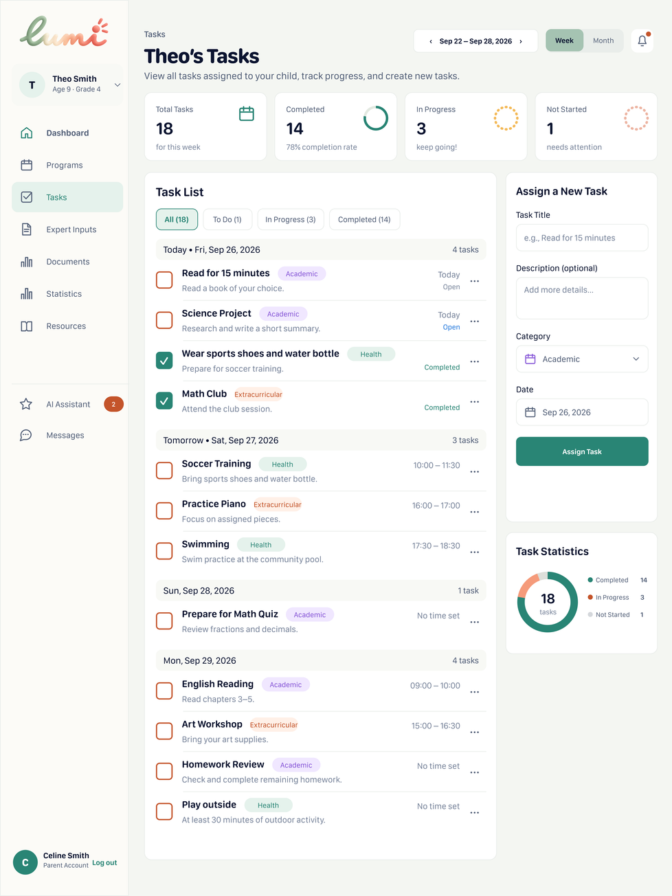

The Tasks interface allows parents to view their child’s assigned tasks, monitor progress, and create new tasks by entering a title, optional description, category, and date. Tasks are grouped by day and can be filtered by completion status. Summary cards and a chart provide an overview of completed, ongoing, and unstarted tasks.

#### Figure 8 - Child’s My Task Page

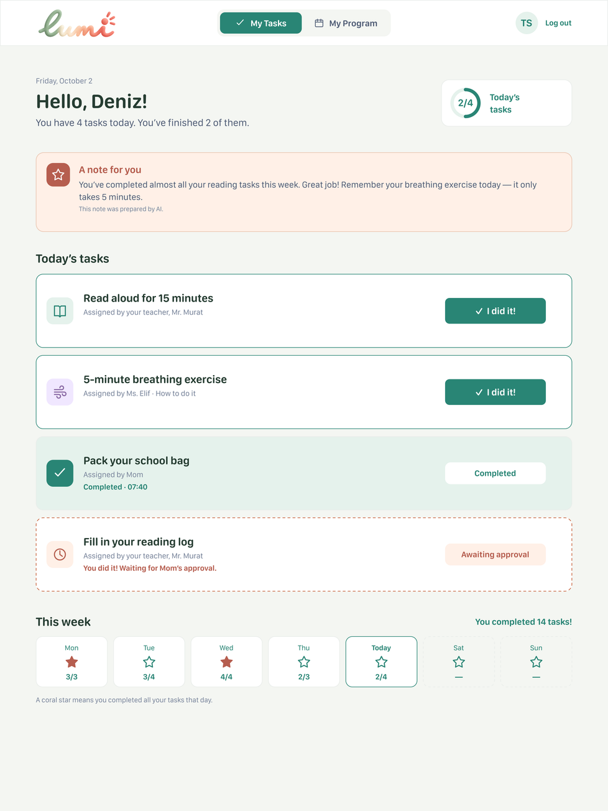

The My Tasks interface displays the child’s daily assignments in a simple list. Children can report task completion using the “I did it!” button and distinguish between pending, completed, and awaiting-approval tasks. Daily and weekly progress indicators provide feedback, while an explicitly labelled AI-generated note offers encouragement and reminders.

#### Figure 9 - Specialist’s Assigned Task Page

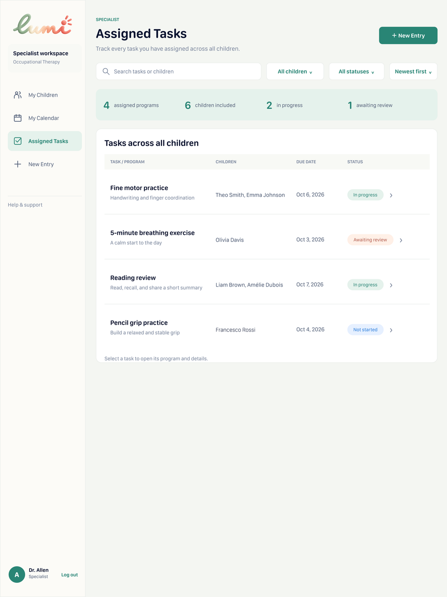

The Assigned Tasks interface displays the tasks and programs assigned by the specialist across all linked children. Each row shows the task title, assigned children, due date, and current status. Search, filtering, and sorting controls help specialists locate assignments. Selecting a task opens its detailed program view.

#### Figure 10 - Specialist’s Task Detailed Program Page

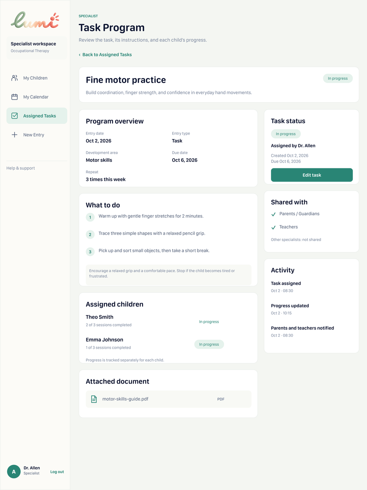

The Task Program interface presents the selected task’s development area, dates, duration, frequency, and step-by-step instructions. It displays each assigned child’s progress separately, together with supporting documents, sharing information, and an activity history. An Edit Task control allows the specialist to update the assignment.

### M5 – Specialist Entries

| ID | Requirement | Priority |
|---|---|---|
| FR-M5-01 | The system shall allow a linked specialist to create an observation for a child by entering an observation date, title, development area and observation text. | Must |
| FR-M5-02 | The system shall display a child's observations to the parent and linked specialists, including each observation's title, text, date, author and category. | Must |
| FR-M5-03 | The system shall allow a specialist who is still linked to the child to edit their own observations and shall display an Edited label and the latest modification timestamp after a change is saved. | Must |
| FR-M5-04 | The system shall hide specialist observations from children and reject their observation API requests with HTTP 403. | Must |
| FR-M5-05 | The system shall reject observation creation if any required field is missing or the specialist is not linked to the selected child. | Must |
| FR-M5-06 | The system shall allow parents and linked specialists to filter observations by author type, development area and date range. | Should |

#### Figure 11 - Parent’s Expert Inputs Page

The Expert Inputs interface allows parents to view teachers’ feedback, specialists’ observations, and AI-generated suggestions about their child’s development. Entries are grouped by date and display their author, input type, content, and relevant categories. Filtering and sorting controls help parents locate specific entries, while an “Edited” label identifies entries modified after their initial submission.

#### Figure 12 - Specialist’s New Entry Page

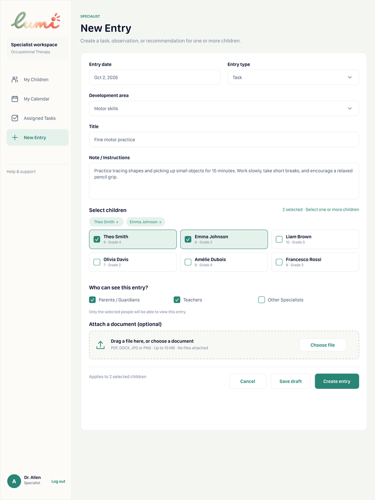

The New Entry interface allows specialists to create tasks, observations, or recommendations for one or more linked children. Specialists can enter the date, type, development area, title, and notes, select who can view the entry, and attach a supporting document.

### M6 – Documents

| ID | Requirement | Priority |
|---|---|---|
| FR-M6-01 | The system shall allow a parent or linked specialist to upload PDF, JPG or PNG files to an accessible child's document collection. | Must |
| FR-M6-02 | The system shall list only documents accessible to the current user, displaying each document's name, file type, uploader and upload date. | Must |
| FR-M6-03 | The system shall allow users to view and download a document only if they currently have permission to access it. | Must |
| FR-M6-04 | The system shall hide documents from children and reject their document upload, list, view and download requests with HTTP 403. | Must |
| FR-M6-05 | The system shall reject unsupported file formats and files larger than 10 MB and display an error message. | Must |
| FR-M6-06 | The system shall allow users to search accessible documents by document name. | Should |
| FR-M6-07 | The system shall allow users to filter accessible documents by category: Reports, Assessments, Health and Forms. | Should |
| FR-M6-08 | The system shall allow the parent to select which linked specialists can view and download each document through the “Who can view this document?” controls. | Must |
| FR-M6-09 | The system shall retain document access for the parent and the uploader while the uploader remains linked to the child. | Must |
| FR-M6-10 | The system shall display the selected specialist recipients in the “Shared with” column and display “Private” when no specialist has access. | Must |
| FR-M6-11 | The system shall reject subsequent document access requests with HTTP 403 when a specialist's document permission is removed or their link to the child is removed. | Must |

#### Figure 13 - Parent’s Documents Page

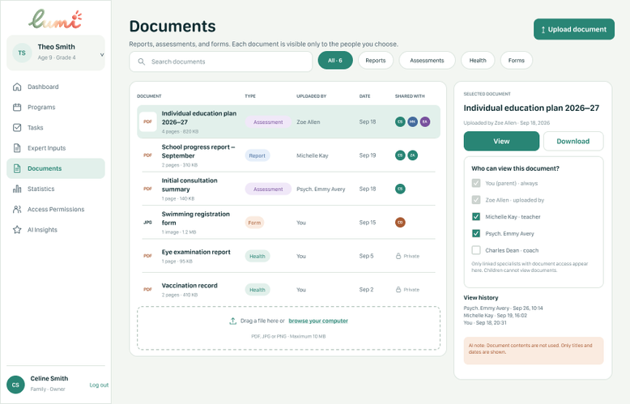

The Documents interface allows parents to upload, search, view, and download their child’s documents. Each document displays its type, uploader, date, and sharing information. Parents can manage access permissions for linked specialists and review the document’s viewing history.

### M7 – Weekly Statistics

| ID | Requirement | Priority |
|---|---|---|
| FR-M7-01 | The system shall allow a parent or linked specialist to select a week and view task statistics for an accessible child. | Must |
| FR-M7-02 | The system shall calculate the weekly completion rate as the number of completed tasks due in the selected week divided by the total number of tasks due in that week, multiplied by 100 and rounded to the nearest whole percentage. | Must |
| FR-M7-03 | The system shall display completed and total task counts and completion percentages for each category. | Must |
| FR-M7-04 | The system shall display N/A for the completion rate when the selected week or development area contains no tasks. | Must |
| FR-M7-05 | The system shall display the number and percentage of tasks with Not Started, In Progress and Completed statuses for the selected week. | Must |
| FR-M7-06 | The system shall display a daily completion chart calculated from the tasks due on each day of the selected week. | Should |
| FR-M7-07 | The system shall display a weekly completion trend showing the completion rate for the selected week and the four preceding weeks. | Should |
| FR-M7-08 | The system shall display the change in Completed, In Progress and Not Started task counts compared with the previous week. | Should |
| FR-M7-09 | The system shall allow users to switch to a monthly view and display task statistics calculated from tasks due in the selected calendar month. | Could |

#### Figure 14 - Parent’s Statistic Page

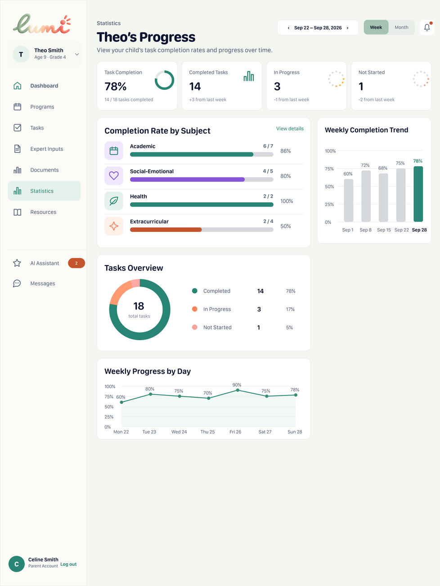

The Statistics interface allows parents to monitor their child’s task completion and progress over time. Summary cards show completed, ongoing, and unstarted tasks, while charts display completion rates by development area and daily and weekly trends. An achievements section highlights progress milestones.

### M8 – Role-Based AI Summary

| ID | Requirement | Priority |
|---|---|---|
| FR-M8-01 | The system shall generate a summary of a selected child's records for a selected week, using separate prompt templates for parents and specialists. | Must |
| FR-M8-02 | The system shall include only records that the requesting user is currently authorized to access in the AI input. | Must |
| FR-M8-03 | The system shall display each summary with an “AI-generated” label, the covered date range and links to its source records. | Must |
| FR-M8-04 | The system shall present AI output as informational support requiring human review and shall not provide diagnoses, treatment recommendations or autonomous decisions. | Must |
| FR-M8-05 | The system shall allow users to submit Helpful or Incorrect feedback for an AI summary. | Must |
| FR-M8-06 | The system shall display a no-records message when the selected week contains no accessible records and an error message with a retry option when summary generation fails. | Must |
| FR-M8-07 | The system shall reject AI summary requests from children and users without access to the selected child with HTTP 403. | Must |
| FR-M8-08 | The system shall display AI suggestion cards containing a category, title, explanation and Apply, Save and Dismiss buttons. | Could |
| FR-M8-09 | The system shall open a prefilled task form when the parent selects Apply and create the task only after the parent reviews and confirms the required task details. | Could |
| FR-M8-10 | The system shall remove a suggestion from the parent's active suggestions list when the parent selects Dismiss and keep it dismissed after the page is reloaded. | Could |

#### Figure 15 - Parent’s Dashboard Page

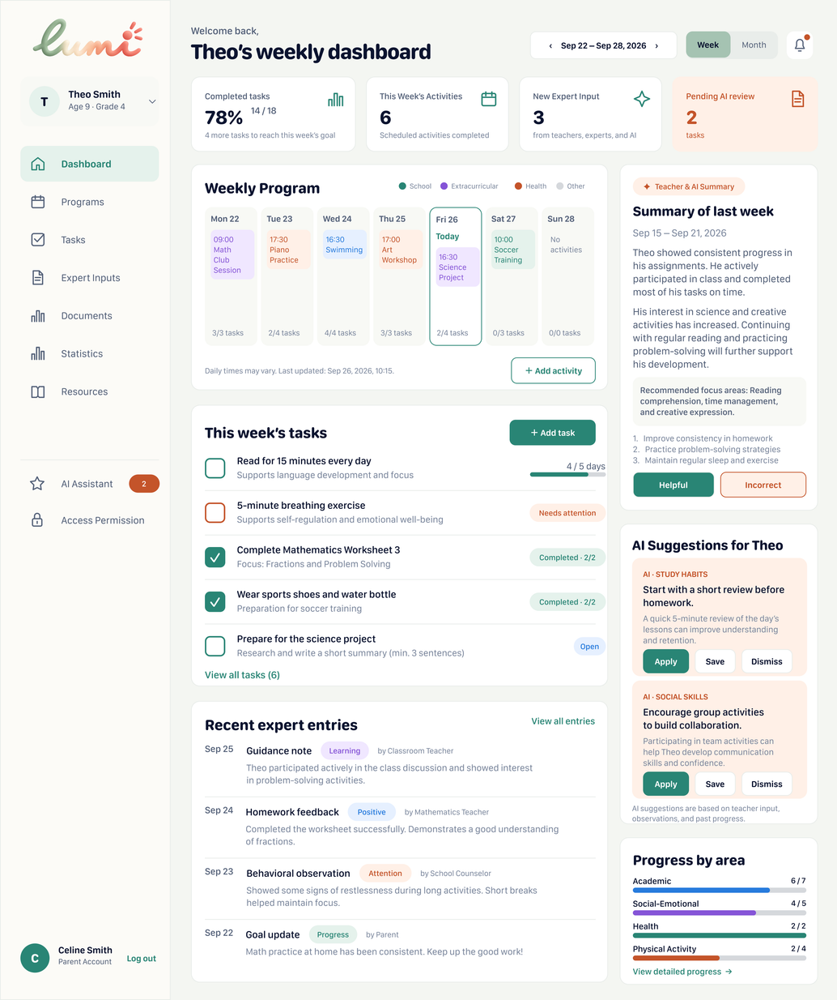

The Dashboard interface provides parents with an overview of their child’s weekly activities, task completion, and development progress. It displays the weekly program, current tasks, recent expert entries, and AI-generated summaries and suggestions. Navigation controls provide access to the system’s main sections.

#### Figure 16 - Parent’s Expert Inputs Page

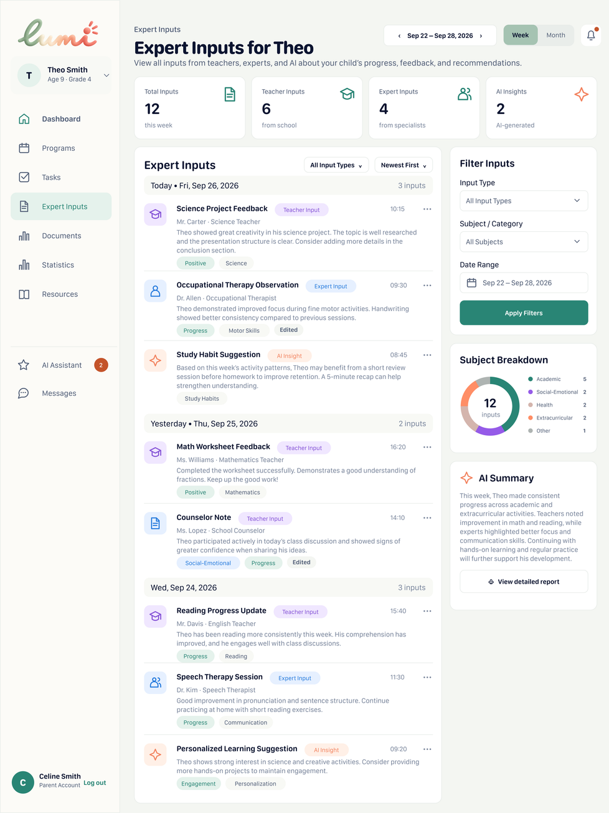

The Expert Inputs interface allows parents to view teachers’ feedback, specialists’ observations, and AI-generated suggestions about their child’s development. Entries are grouped by date and display their author, input type, content, and relevant categories. Filtering and sorting controls help parents locate specific entries, while an “Edited” label identifies entries modified after their initial submission.

---
